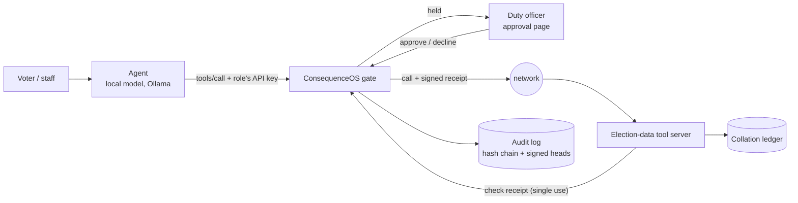

# Architecture and Technical Design

## 1. Overview

An election body runs AI agents for four jobs: answering voters, transmitting polling-unit results, drafting public bulletins, and helping analysts. Every tool call an agent makes passes through a **policy gate** ([ConsequenceOS](https://github.com/Matutozi/Consequence-OS)). The gate decides the call by the agent's role, holds consequential calls for a person, signs a receipt for each call it allows, and records everything in a hash-chained audit log. The **election-data tool server** runs a call only with a valid receipt for exactly that call.

## 2. Components

| Component | Responsibility | Tech | Code |
|---|---|---|---|
| Agent | Turns a person's request into tool calls; tells them what happened | Python, Ollama, Qwen2.5-3B (any tool-calling model) | `src/guarded_assistant/agent.py` |
| Gate | Authenticates each agent by key, decides each call by policy, holds calls for approval, signs receipts, keeps the audit log | ConsequenceOS `consequenced` (Go) | [config/consequence.yaml](../config/consequence.yaml) |
| Approval page | Shows a held call with its rule and reasons; the duty officer approves or declines | ConsequenceOS | served by the gate |
| Tool server | The election body's systems: 12 tools over the data pack; refuses any call without a valid receipt, and any argument its schema doesn't name | Python, Starlette, `consequence_verify` | `server.py`, `tools.py` |
| Result checks | Consistency flags on each result sheet, for human review | Python | `checks.py` |
| Collation ledger | Append-only record of transmissions, bulletins and escalations, each with the receipt that allowed it | JSON lines | `.run/ledger.jsonl` |
| Launcher and tap | Starts everything locally; the tap stands for the network, so tests can capture, replay and alter real traffic | Python | `stack.py` |

## 3. Data flow

1. A person asks the agent something. The agent sends the question and the tool list to the local model; nothing leaves the machine.
2. The model picks a tool. The agent sends the call to the gate with its role's API key.
3. The gate checks the arguments are unambiguous (no duplicate keys, no names differing only in case), finds the first matching rule, and:
   - **allows**: signs a receipt bound to the tool, the exact arguments, the receiver and a five-minute expiry, and forwards the call;
   - **denies**: answers the agent with the rule's name, and the agent tells the person;
   - **asks**: opens an approval and answers "approval pending"; once a person approves, the same call goes through once.
4. The tool server sends the receipt back to the gate's verify endpoint, which checks both signatures, the tool, the arguments, the expiry and that it hasn't been used, and marks it used. Only then does the tool run.
5. The gate's audit log records each decision: who, which tool, which rule, the outcome, a hash of the arguments (never the values) and the receipt or approval ID.

**Personal data:** none in this prototype; the data pack is synthetic. In a real deployment, voters' questions reach only the local model, and the audit log holds argument hashes, not values. Survey responses are released only as aggregates over five or more respondents. Retention: the audit log can be archived to a signed file and deleted past a retention date (`consequenced -archive-audit`); the ledger is the election body's record and follows its own rules.

## 4. Models and logic

- **Language model:** a small open model run locally (default `qwen2.5:3b` via Ollama), temperature 0, with a system prompt per role. It is **not trusted**: nothing in the design depends on it behaving.
- **Policy:** 13 rules, first match wins, in [config/consequence.yaml](../config/consequence.yaml). Calls no rule matches: reads are allowed, anything else asks a person.
- **Result checks:** fixed rules (see [METHODOLOGY.md](METHODOLOGY.md)); no training.
- **Abstention:** where the FAQ has no verified answer, the tool says so and refers the voter to official channels; the model is told never to guess procedures. After six tool calls without an answer, the agent stops and refers the person to staff.

## 5. Human oversight points

| Action | Who decides | If no one is available |
|---|---|---|
| Publishing a bulletin | Duty officer, on the approval page | Nothing is published; the approval expires after an hour |
| Escalating an incident | Duty officer | Nothing is escalated |
| A result sheet that raises a flag | A reviewer, from the ledger's flagged entries | The sheet is recorded and stays flagged; nothing is declared |
| More than 30 transmissions in an hour from one officer | Duty officer | Further transmissions wait |
| Declaring a result | The returning officer, in person; no agent can | — |

At most 20 approvals can wait per agent at once, so a manipulated agent can't bury the duty officer in requests.

## 6. Security and privacy design

**Authentication:** each agent has its own API key (one per role), looked up by its SHA-256, so response times reveal nothing about it. The tool server has its own receiver key for the verify endpoint. The admin token (audit log) is separate; the gate refuses to start if two credentials are the same.

**Access control:** role-based, in the policy: rules name the agents they apply to, and an agent's identity comes only from its key.

**Secrets:** generated on first run into `.run/keys.env`, readable by its owner only, and never committed (`.run/` is ignored). The config names environment variables; it holds no secrets.

**Audit:** every decision, approval and refusal is an entry in a hash chain: editing, deleting or reordering an entry breaks every link after it. The gate signs heads of the chain, so removing the newest entries shows too, once a head was saved. Heads can be anchored on a public chain (ConsequenceOS's `consequence-anchor`) where the operator can't rewrite them.

**In transit:** the prototype runs on one machine over localhost HTTP. A deployment needs TLS between every component.

**Dependencies:** a handful of maintained, permissively licensed libraries (Starlette, Uvicorn, httpx); the gate is a static Go binary with two dependencies.

### Threat model (STRIDE)

| Threat | Component | Mitigation | Residual risk |
|---|---|---|---|
| **S**: an agent acts as another role | Gate | Role comes from the API key, never from the request; rules name roles by ID | A stolen agent key acts as that role; keys are per role, so the damage is bounded by the role, and every call is logged |
| **S**: someone calls the tool server directly | Tool server | Every call needs a receipt signed by the gate, checked online | Tested: refused |
| **T**: arguments changed on the network | Network | The receipt binds the exact arguments' hash and the tool | Tested: votes altered in flight, and a question turned into a transmission, are both refused |
| **T**: a captured call replayed | Network | Receipts are single use and expire in five minutes | Tested: refused |
| **T**: the audit log edited | Gate | Hash chain; signed heads; optional public anchoring | Someone with database access can still delete everything after the last saved head; save or anchor heads often |
| **T**: the collation ledger edited | Tool server | Each entry carries the receipt ID, which the audit log also records | The ledger itself isn't chained in this prototype; a production ledger should be |
| **R**: "I never approved that" | Approvals | The approval, the approver and the decision go in the audit log before the decision takes effect; the receipt names the approver | Approvers are identified by their emailed link, not by a strong login (passkeys are planned in ConsequenceOS) |
| **I**: respondents' personal answers read | Tool server | `survey.respondents` denied to every agent; aggregates need groups of 5+, enforced by both the gate and the tool | Several overlapping aggregates could still narrow a group (differencing); a production system needs a query budget or differential privacy |
| **I**: argument values in logs | Gate | The audit log keeps a hash and a short summary, never values | — |
| **D**: approval flooding | Gate | At most 20 pending approvals per agent | A flooded agent can't get new approvals until its queue drains |
| **D**: the gate is down on election day | Gate | It fails closed: nothing passes unchecked | Availability: agents stop until it's back; paper processes remain the fallback |
| **E**: prompt injection makes the model act | Agent → gate | The role bounds what any call can do; consequential calls wait for a person | The model can still *say* something wrong to a voter in its reply; replies aren't checked, only actions |
| **E**: a tool's definition changed to mislead the model | Tool server → gate | The gate pins tool definitions at first listing; a changed tool is hidden and asks until a person accepts it | — |
| **E**: an argument the policy never saw | Gate, tool server | Arguments not in the pinned schema are refused by the gate, which lists the tools itself if a call comes before any listing; the tool server refuses them too | Tested: refused, including from a client that never lists the tools |

## 7. Deployment and operations

- **Locally:** `python -m guarded_assistant.stack` starts the gate (8080), the tool server (9090) and the tap (9091); logs go to `.run/logs/`.
- **Resources:** the gate uses about 15 MB of memory and the tool server about 30 MB; the model needs about 2–3 GB (GPU or CPU).
- **Offline:** everything runs without network access once installed.
- **Monitoring:** `consequenced -report` summarises what was allowed, held and refused per rule; `consequenced -verify-audit` checks the log's chain and exits non-zero if it was changed, for cron or CI.

## 8. Scalability and sustainability

- **Throughput:** a call through the gate takes about 20–26 ms on a 2017 laptop, tool included; the gate itself adds about 1.5 ms when the store is in memory. Nigeria has about 177,000 polling units, each transmitting once; a single gate handles that comfortably.
- **State:** the prototype keeps the gate's state in files; ConsequenceOS also runs on Postgres for several gate instances.
- **Other uses:** the policy is plain YAML, tested in CI with `consequenced -test`; the same gate guards any MCP tool server, so the design carries over to other election systems (logistics, observer reporting) by writing policy, not code.
- **Openness:** MIT (this prototype) and Apache-2.0 (ConsequenceOS); no proprietary services.

## 9. Decisions log

| Date | Decision | Alternatives | Reason |
|---|---|---|---|
| 2026-11-13 | Control actions with a gate, rather than filter the model's text | Prompt hardening; output classifiers | A model can be phrased around; a role's permissions can't |
| 2026-11-13 | One API key per role, roles in the policy | One key with a role field in the request | A role the request carries is a role the model can claim |
| 2026-11-13 | The tool server checks every receipt online | Trust the network; check offline | Online checks enforce single use, which stops replays |
| 2026-11-13 | Flag result sheets, never refuse them | Reject inconsistent sheets | The rules forbid tools deciding results; a person reviews |
| 2026-11-13 | Local open model | Hosted API | Questions stay on the device; works offline; no per-call cost |
